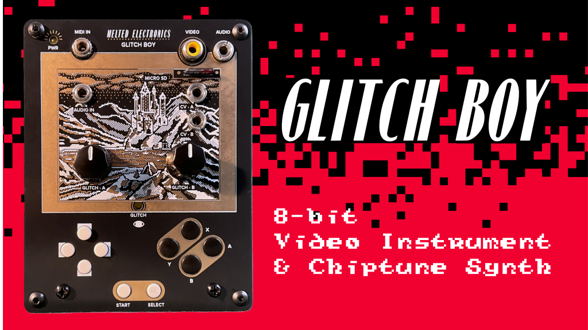
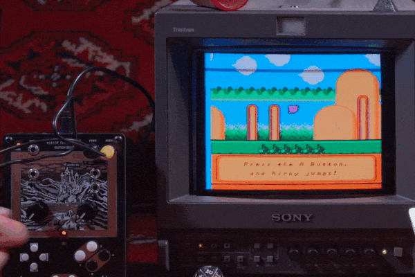
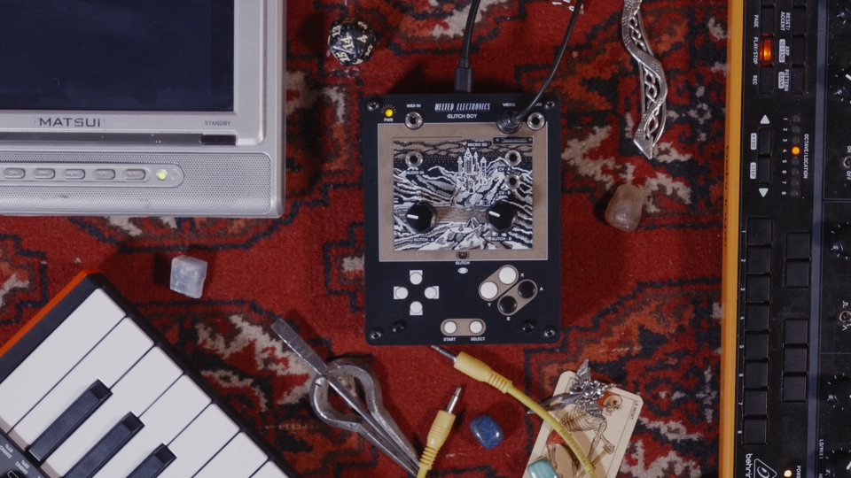
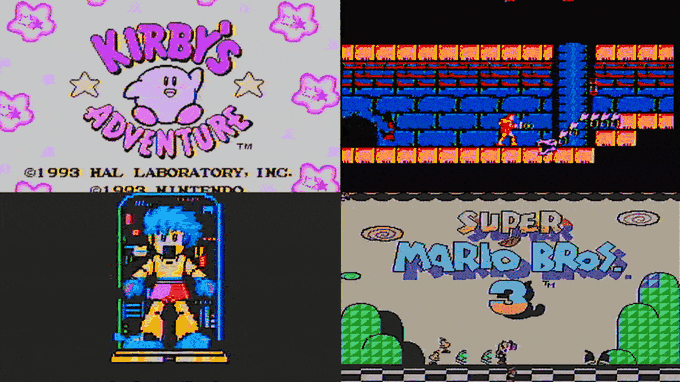
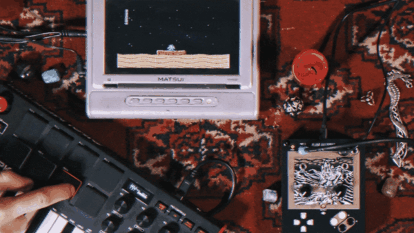
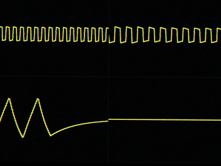
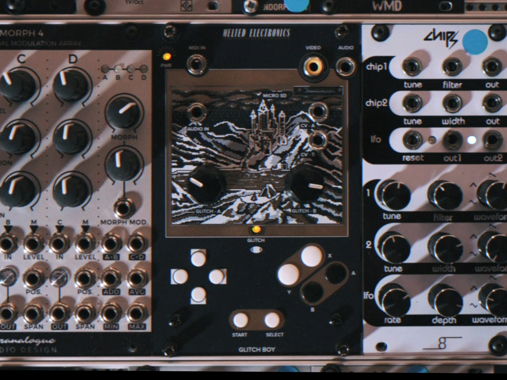
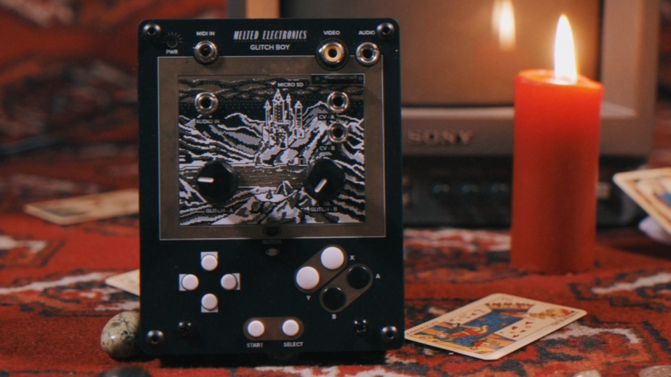

# Glitch Boy



I'm Martino from Melted Electronics, and I'm excited to finally announce the Glitch Boy: a compact device that turns a retro console into a video synthesizer and chiptune instrument.

Built by intentionally breaking a NES emulator, it's a tool for video artists and creatives, perfect for creating authentic 8-bit glitch aesthetics for visuals, music videos, and video art.



Load your games from microSD onto the Glitch Boy, then glitch them in real time with onboard controls, or sync the corruptions to music using the audio input or MIDI to create unique visuals.



The Glitch Boy is not only a video synth, but also an 8-bit audio synthesizer: you can play console's sound chip via MIDI, turning it into an authentic chiptune instrument.

The firmware will be open source and hackable, allowing custom mappings, new glitch behaviors, and all kinds of extension.

The device is available in both standalone and Eurorack versions. Output is analog composite video like the original console, with support for both NTSC and PAL.

- [Glitch Boy on Kickstarter](https://www.kickstarter.com/projects/meltedelectronics/glitch-boy)
- [meltedelectronics.com](https://meltedelectronics.com/)

## Glitches

All the glitches are faithful emulations of real hardware mods, corrupting the console's memory state without ever crashing the system.

Each game becomes a new visual palette for the instrument, ready to be remixed and distorted into endless combinations.



The Glitch A knob affects the CPU of the NES, creating flickering sprite effects and corrupting the music and sound effects.

The Glitch B knob affects the PPU, the console’s graphics processor, producing corrupted backgrounds and sprites.

The X and Y buttons are meant to control the glitch effects while you play: X turns the current glitch setting on and off, allowing for manual rhythmic performance, while Y glitches the image progressively more with each press, and then decays gradually.

## MIDI Control

Turn your keyboard into a game controller: Glitch Boy lets you map any MIDI note to a controller button press.



The controls on the Glitch Boy can also be automated by sending MIDI notes or controller messages from a sequencer, instrument or your preferred performance software / DAW.

For instance you can control the glitch intensity with a Max/MSP patch, or with an Ableton automation envelope.

Or just send MIDI clock from any external device and synchronize the glitches using it as a reference.

## Chiptune Audio Synthesizer

MIDI compatibility means that you can also play the emulated NES sound chip as a proper 4-voice chiptune synth with two pulse channels, one triangle and one noise channel. Each of the four voices can be played independently from a separate MIDI channel.



The synth voice parameters, such as pulse duty, volume, envelope, and length, are also controllable via MIDI CC.

The APU - the console "soundcard" -  can be glitched even when driving the audio engine with external MIDI, letting you corrupt your own MIDI sequences at will.

## Eurorack Friendly

Glitch Boy is compatible with the Eurorack modular standard: you can send CV signals like gates, envelopes and LFOs from your modular gear into the Glitch Boy's CV - A and CV - B inputs to make the glitches evolve in time with your patches.



The Eurorack Glitch Boy has all the same features and capabilities as the desktop unit, and the circuit board inside is exactly the same, making it possible to switch from desktop to Eurorack simply by changing the panel.

## Wireless Controller Support

Glitch Boy is compatible with Xbox-style Bluetooth controllers, Switch controllers and Wiimotes, letting you play and control the glitches without being close to the unit.



## Specs

**Video Output**

- NTSC (Composite Video Output)
- PAL (Composite Video Output)

**Audio**

- 1/8" Mini jack Mono Line Input

**MIDI**

- 1/8" Mini MIDI jack (TRS Type A connection)

**CV**

- 2x 0-5v CV inputs, 1/8" jack

**Storage**

- SD card up to 32 GB (not included)

**Standalone dimensions**

- 7.4 x 4.7 x 1.6" / 19 x 12 x 4 cm (including knobs).
- Powder Coated Aluminum

**Eurorack dimensions**

- 16 HP, 6 cm depth

**Power requirements:** 5v - 0.2A

## About Melted Electronics

Melted Electronics is an analog video art brand creating accessible, hands-on tools for glitch artists, performers, and experimental image makers.

We have been in business for 5+ years and shipped several hundreds of glitch machines all over the world, like the Chroma Corruptor, Mutant Enhancer and Strange Loop.

You can find us on Etsy as well.

---

# Firmware

The firmware is an Arduino sketch for the ESP32 in `firmware/GlitchBoy/`. It runs a NES core (Nofrendo) and a Game Boy / Game Boy Color core (Walnut-CGB).

## Building

Arduino ESP32 core 1.0.6, no extra libraries:

```
arduino-cli compile --fqbn esp32:esp32:esp32 firmware/GlitchBoy
```

Keep the build path short, long paths break the NimBLE build.

The default video standard and emulator are set at the top of `GlitchBoy.ino`. Both can also be changed from the System menu on the device.

## SD card

Put NES games in a folder called `nofrendo` and Game Boy / Game Boy Color games in a folder called `gameboy`. A `Games` folder is read too. Sub-folders show up in the game list: A opens one, B goes back.

## Hardware I/O

### Core signal pins

| Function | GPIO | Notes |
| --- | --- | --- |
| Composite video out | `25` | DAC1, driven by the I2S0/APLL video path |
| Audio out | `2`, `12`, `18` | MCP4822 SPI DAC: SCK=`2`, SDI=`12`, CS=`18`; LDAC tied low, SHDN tied high |
| MIDI in | `27` | serial MIDI input |
| Optional IR receiver | `0` | TSOP38238 / TSOP4838 style receiver |

### Front-panel buttons

| Control | GPIO |
| --- | --- |
| A | `19` |
| B | `26` |
| Select | `23` |
| Start | `21` |
| Up | `4` |
| Down | `22` |
| Left | `17` |
| Right | `16` |

### Analog / CV / audio-reactive inputs

| Function | GPIO | ADC use |
| --- | --- | --- |
| Glitch pot 1 | `36` | ADC1 channel 0 |
| Glitch pot 2 | `32` | ADC1 channel 4 |
| CV input 1 | `34` | ADC1 channel 6 |
| CV input 2 | `35` | ADC1 channel 7 |
| Audio-reactive input | `39` | ADC1 channel 3 |

### microSD wiring

| Function | GPIO |
| --- | --- |
| SD MISO | `33` |
| SD MOSI | `13` |
| SD SCK | `14` |
| SD CS | `5` |

## Credits

Glitch Boy started as a fork of Peter Barrett's `esp_8_bit`. The NES core is Nofrendo by Matthew Conte. The Game Boy core is [Walnut-CGB](https://github.com/Mr-PauI/Walnut-CGB) by Mr. Paul, based on [Peanut-GB](https://github.com/deltabeard/Peanut-GB) by Mahyar Koshkouei. Game Boy audio is [minigb_apu](https://github.com/deltabeard/minigb_apu), based on [MiniGBS](https://github.com/baines/MiniGBS) by Alex Baines. The music visualizer is a port of VID PIX PAL by Synthrotek Sound Study Modular.

`esp_8_bit` is still the name of the NVS namespace. Changing it would wipe saved settings and Bluetooth pairings on existing units.

## License

Mixed licenses. [LICENSE](LICENSE) covers the Glitch Boy files; everything else keeps its own license. The music visualizer is GPL-3.0-or-later, so the firmware as a whole is distributed under GPLv3. See [THIRD_PARTY_NOTICES.md](THIRD_PARTY_NOTICES.md), [SOURCE_AND_RELINKING_OFFER.md](SOURCE_AND_RELINKING_OFFER.md) and the texts in [licenses/](licenses/).
